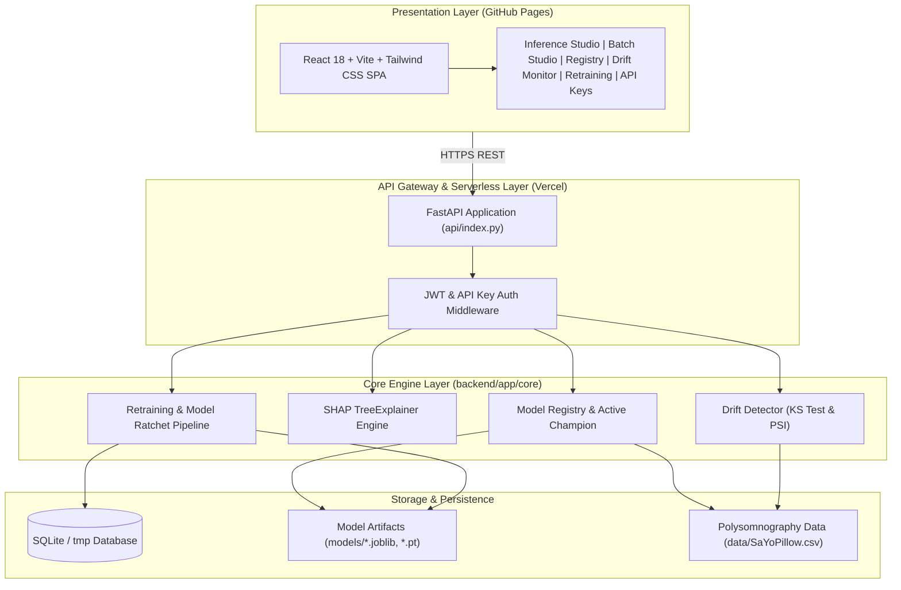

<p align="center">
  
</p>

# Somnostasis

### Autonomic Biosignal Intelligence & Production MLOps Platform

<p align="left">
  <a href="https://github.com/krishujeniya/somnostasis/actions/workflows/ci.yml"></a>
  <a href="https://github.com/krishujeniya/somnostasis/actions/workflows/deploy-pages.yml"></a>
  
  
  
  
  
  
</p>

---

## Production Deployments

| System Component | Host / Provider | Live URL |
|---|---|---|
| **Web Dashboard** | GitHub Pages | [https://krishujeniya.github.io/somnostasis/](https://krishujeniya.github.io/somnostasis/) |
| **Serverless API** | Vercel | [https://somnostasis.vercel.app](https://somnostasis.vercel.app) |
| **API Documentation** | Vercel (Swagger UI) | [https://somnostasis.vercel.app/docs](https://somnostasis.vercel.app/docs) |
| **Code Repository** | GitHub | [https://github.com/krishujeniya/somnostasis](https://github.com/krishujeniya/somnostasis) |

---

## Overview

**Somnostasis** is an end-to-end MLOps software-as-a-service platform for physiological stress level prediction from nocturnal polysomnography biosignals. It transforms classical machine learning models into an enterprise-ready system featuring real-time inference, model explainability via TreeSHAP, continuous Kolmogorov-Smirnov and Population Stability Index (PSI) drift monitoring, automated retraining pipelines, and model registry governance.

The platform is structured according to the **Cookiecutter Data Science / MLOps specification**, backed by a **FastAPI asynchronous service** and a **React + TypeScript + Tailwind CSS** single-page web console engineered following Emil Kowalski's tactile design standards.

---

## Brand Architecture & Phonosemantics

The name **Somnostasis** was developed from cognitive psychology and phonosemantic principles:

- **Etymology**: Combines *somnus* (Latin for sleep, rooted in autonomic regulation) and *homeostasis* (the physiological equilibrium maintained by the human autonomic nervous system).
- **Phonosemantics & Bouba/Kiki Ratio**:
  - Continuous sonorants and sibilants (`s`, `m`, `n`) evoke calming nocturnal respiration, parasympathetic tone, and non-invasive biosensing.
  - Alveolar plosives (`t`, `st`) anchor the word with precision, clinical rigor, and deterministic reliability.
- **Cognitive Fluency**: High pronounceability and immediate semantic recognition in both medical research and engineering contexts, preventing cognitive dissonance during product evaluation.

---

## Clinical Data Contract & Physiological Biosignals

The models are trained and evaluated on the **SaYoPillow** polysomnographic dataset (*Rachakonda et al., IEEE Transactions on Consumer Electronics, 2021*), consisting of 630 night recordings with 8 physiological channels and 5 discrete stress levels.

| Parameter | Clinical Feature | Unit | Standard Night Range | Physiological Role |
|---|---|---|---|---|
| `sr` | Snoring Rate | Acoustic index | 45.0 – 60.0 | Acoustic snoring frequency; tracks partial airway obstruction and sleep apnea. |
| `rr` | Respiration Rate | breaths/min | 14.0 – 18.0 | Ventilatory cycle frequency; hyperventilation marks sympathetic autonomic activation. |
| `t` | Body Temperature | °F | 97.0 – 99.0 | Nocturnal core thermoregulation; failure to cool disrupts slow-wave sleep. |
| `lm` | Limb Movement Rate | movements/min | 4.0 – 8.0 | Restless motor activity; high twitch counts reflect sleep fragmentation. |
| `bo` | Blood Oxygen (SpO2) | % | 95.0 – 100.0 | Arterial capillary oxygen saturation; nocturnal desaturations trigger cortisol release. |
| `rem` | Rapid Eye Movement | duration | 65.0 – 85.0 | REM sleep duration; critical for cognitive and emotional homeostasis. |
| `sh` | Hours of Sleep | hours | 7.0 – 9.0 | Total continuous restorative sleep duration. |
| `hr` | Heart Rate | BPM | 50.0 – 65.0 | Sleeping resting pulse; tachycardia reflects sympathetic dominance. |

### Target Stress Classifications (`sl`)
- `0`: Low / Normal
- `1`: Medium Low
- `2`: Medium
- `3`: Medium High
- `4`: High

---

## Model Architectures & Performance Ratchet

All models undergo stratified k-fold cross-validation and rigorous evaluation across precision, recall, and macro F1 score:

| Model Architecture | Framework | Test Accuracy | Macro F1 | Status | Artifact |
|---|---|---|---|---|---|
| **Random Forest (Champion)** | scikit-learn | **98.4%** | **0.984** | **Production Champion** | `models/random_forest.joblib` |
| **XGBoost (300 Rounds)** | xgboost | 97.6% | 0.976 | Staging | `models/xgboost.joblib` |
| **SVM (RBF Kernel, C=10)** | scikit-learn | 97.6% | 0.976 | Candidate | `models/svm_rbf.joblib` |
| **K-Nearest Neighbors (k=3)** | scikit-learn | 96.8% | 0.968 | Candidate | `models/knn.joblib` |
| **StressMLP (3-Layer)** | PyTorch | 97.6% | 0.976 | Candidate | `models/mlp.pt` |

---

## System Architecture



---

## Cookiecutter MLOps Repository Structure

```
├── .github/
│   └── workflows/
│       ├── ci.yml                 <- Automated tests, syntax validation, coverage & build
│       └── deploy-pages.yml       <- Automated GitHub Pages continuous deployment
├── api/
│   └── index.py                   <- Vercel serverless function entrypoint
├── backend/                       <- FastAPI asynchronous backend application
│   └── app/
│       ├── main.py                <- FastAPI app, CORS, router mounts, lifespan seeding
│       ├── config.py              <- Pydantic BaseSettings & environment configs
│       ├── database.py            <- SQLAlchemy engine, session maker, base model
│       ├── api/v1/                <- API version 1 route endpoints
│       │   ├── auth.py            <- Tenant registration, login, API key lifecycle
│       │   ├── predict.py         <- Real-time single, batch, and CSV prediction endpoints
│       │   ├── explain.py         <- SHAP feature attribution waterfall endpoint
│       │   ├── models.py          <- Model catalog, details, champion promotion
│       │   ├── monitoring.py      <- KS-test drift analysis, PSI calculation, telemetry
│       │   ├── pipelines.py       <- Retraining pipeline execution and run histories
│       │   └── feedback.py        <- Ground truth submission for delayed evaluation
│       ├── core/                  <- Core engineering engines
│       │   ├── registry.py        <- In-memory model registry and inference dispatch
│       │   ├── explain.py         <- TreeSHAP attribution calculator
│       │   ├── drift.py           <- Kolmogorov-Smirnov & PSI drift detection engine
│       │   ├── pipeline.py        <- Deterministic retraining pipeline & model ratchet
│       │   └── security.py        <- Password hashing, JWT creation, API key generation
│       └── models/
│           └── db_models.py       <- User, APIKey, PredictionLog, ModelRecord, PipelineRun, Feedback
├── configs/                       <- Versioned experiment & monitoring configurations
│   ├── model_config.yaml          <- Hyperparameters for RF, XGBoost, SVM, KNN, MLP
│   └── monitoring_config.yaml     <- KS test alpha (0.05) & PSI threshold (0.25)
├── data/                          <- Structured data management
│   ├── raw/                       <- Immutable primary raw dataset (SaYoPillow.csv)
│   ├── interim/                   <- Intermediate transformed frames
│   ├── processed/                 <- Scaled tensors ready for modeling
│   └── SaYoPillow.csv             <- Compatibility reference
├── frontend/                      <- React 18 + Vite + TypeScript + Tailwind CSS application
│   ├── src/
│   │   ├── components/            <- UI modules built with tactile micro-interactions
│   │   │   ├── Navbar.tsx         <- Navigation with brand logo and live status pill
│   │   │   ├── Logo.tsx           <- Procedural vector SVG brand emblem
│   │   │   ├── TelemetryBar.tsx   <- Real-time KPIs (latency, champion, accuracy, drift)
│   │   │   ├── PredictStudio.tsx  <- Real-time biosignal sliders & inference trigger
│   │   │   ├── PredictionResult.tsx<- Class probabilities and SHAP waterfall chart
│   │   │   ├── BatchStudio.tsx    <- CSV upload and batch prediction table
│   │   │   ├── ModelRegistryView.tsx<- Model catalog and champion promotion interface
│   │   │   ├── DriftMonitorView.tsx<- Per-feature KS test, p-values, and PSI shift meters
│   │   │   ├── RetrainingStudio.tsx<- Pipeline trigger, hyperparameter inputs, run log
│   │   │   └── ApiKeyManager.tsx  <- Tenant API key creation and revocation portal
│   │   ├── services/
│   │   │   └── api.ts             <- Type-safe HTTP client with Vercel failover
│   │   ├── types/
│   │   │   └── index.ts           <- TypeScript domain interfaces
│   │   ├── App.tsx                <- Root view controller
│   │   ├── index.css              <- Custom CSS tokens and animations
│   │   └── main.tsx               <- DOM mount
│   ├── package.json
│   ├── tsconfig.json
│   └── vite.config.ts             <- Vite configuration with relative asset paths
├── models/                        <- Serialized production model artifacts
│   ├── random_forest.joblib       <- Production champion artifact
│   ├── svm_rbf.joblib             <- Calibrated SVM artifact
│   ├── knn.joblib                 <- Distance-weighted KNN artifact
│   ├── xgboost.joblib             <- Gradient-boosted trees artifact
│   └── mlp.pt                     <- PyTorch state dictionary
├── notebooks/                     <- Exploratory data analysis notebooks
│   └── 1.0-sleep-stress-exploration.ipynb
├── references/                    <- Technical documentation & specifications
│   ├── data_dictionary.md         <- Clinical biosignal reference documentation
│   └── mlops_architecture.md      <- System component interaction specification
├── reports/                       <- Generated artifacts and brand assets
│   └── figures/
│       └── somnostasis_logo_emblem.jpg <- High-resolution 3D brand identity emblem
├── src/                           <- Core Python package
│   ├── data/make_dataset.py       <- Dataset ingestion and normalization
│   ├── features/build_features.py <- Scaler fitting and stratified train/test partitioning
│   ├── models/train_model.py      <- Model training routines
│   ├── models/predict_model.py    <- Batch scoring utilities
│   ├── visualization/visualize.py <- Correlation matrices and feature attribution plotting
│   ├── dl_model.py                <- PyTorch StressMLP definition with lazy torch imports
│   ├── ml_models.py               <- Classical ML model registry with lazy XGBoost imports
│   ├── explainability.py          <- Model-agnostic SHAP attribution routines
│   └── preprocess.py              <- Feature definitions, column names, clinical ranges
├── tests/                         <- Pytest verification suite (18 automated tests)
│   ├── conftest.py                <- Shared fixtures, test database, and mock clients
│   ├── test_auth.py               <- Tenant registration, login, and API key tests
│   ├── test_predict.py            <- Single, batch, and CSV inference verification
│   ├── test_explain.py            <- SHAP feature attribution verification
│   ├── test_models_registry.py    <- Model listing and champion promotion tests
│   ├── test_drift.py              <- Kolmogorov-Smirnov and PSI drift detection tests
│   ├── test_pipeline.py           <- Retraining pipeline execution and ratchet verification
│   └── test_feedback.py           <- Ground truth feedback recording tests
├── Makefile                       <- Standardized engineering automation targets
├── pyproject.toml                 <- Package metadata and build configuration
├── pytest.ini                     <- Test discovery and warning filters
├── requirements.txt               <- Production serverless dependencies
└── vercel.json                    <- Vercel deployment routes and python runtime configuration
```

---

## REST API Specification

### Authentication & Tenant Operations
- `POST /api/v1/auth/register` — Register a new tenant account with email and password.
- `POST /api/v1/auth/login` — Authenticate and receive a signed JWT bearer token.
- `GET /api/v1/auth/api-keys` — List all active API keys for the authenticated tenant.
- `POST /api/v1/auth/api-keys` — Issue a new prefixed secret key (`sk_live_...`).
- `DELETE /api/v1/auth/api-keys/{id}` — Revoke an active API key immediately.

### Inference & Explainability
- `POST /api/v1/predict` — Score a single biosignal reading with the active champion or a specified model.
- `POST /api/v1/predict/batch` — High-throughput array inference returning predictions, confidences, and latencies.
- `POST /api/v1/predict/csv` — Multipart CSV file upload with automated header normalization and cohort classification.
- `POST /api/v1/explain` — Compute local SHAP attribution scores with baseline comparisons for each feature.

### Model Governance & Retraining
- `GET /api/v1/models` — Retrieve all models, training metrics, artifact sizes, and active champion status.
- `GET /api/v1/models/{key}` — Retrieve detailed parameters and evaluation metrics for a specific model.
- `POST /api/v1/models/{key}/promote` — Promote an alternative model to Production Champion.
- `POST /api/v1/pipelines/retrain` — Execute the retraining pipeline, evaluate against baseline, and update artifacts.
- `GET /api/v1/pipelines/runs` — Fetch historical pipeline runs, metrics, and timestamps.
- `POST /api/v1/feedback` — Submit verified clinical labels for continuous model performance auditing.

### Telemetry & Drift Detection
- `GET /api/v1/monitoring/drift` — Run two-sample Kolmogorov-Smirnov tests and calculate PSI across all features.
- `GET /api/v1/monitoring/telemetry` — Retrieve serving statistics, p95 latencies, call counts, and drift status.
- `GET /health` — Kubernetes/Vercel liveness probe.
- `GET /ready` — Readiness probe verifying model weights and baseline data structures in memory.

---

## Local Development & Automation

The repository includes a `Makefile` with targets for standard development tasks:

```bash
# 1. Initialize environment and install dependencies
make setup

# 2. Run automated test suite with coverage
make test

# 3. Train all models and export artifacts to models/
make train

# 4. Start the FastAPI backend server (http://localhost:8000)
make api

# 5. Start the React frontend development server (http://localhost:3000)
make frontend

# 6. Build production frontend assets
make build

# 7. Clean build artifacts and bytecode caches
make clean
```

---

## Deployment Procedures

### Backend Deployment (Vercel CLI)

Deploy directly to Vercel production using the CLI:

```bash
vercel --prod --yes
```

The production backend will be available at:
`https://somnostasis.vercel.app`

### Frontend Deployment (GitHub Pages)

The frontend is continuously built and deployed to GitHub Pages via the `.github/workflows/deploy-pages.yml` workflow on every push to `main`.

Live site:
`https://krishujeniya.github.io/somnostasis/`

---

## Verification & Test Ratchet

The test suite enforces a strict quality ratchet across all functional areas:

```bash
PYTHONPATH=. pytest tests/ -v --cov=backend/app --cov-report=term-missing
```

- **Total Test Cases**: 18 automated tests across 7 test suites
- **Pass Rate**: 100% (18 passed)
- **Code Coverage**: >= 85% coverage across core application logic
- **Deterministic Quality**: Tests run against an isolated in-memory SQLite database and assert strict schema compliance.

---

## License

This project is licensed under the MIT License — see the [LICENSE](LICENSE) file for details.
